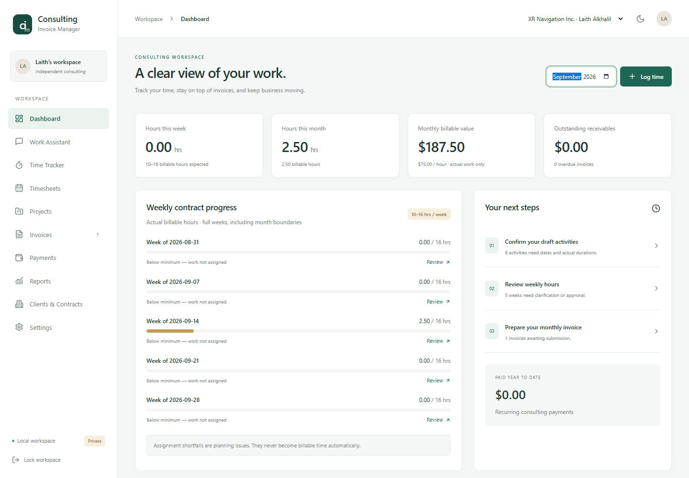
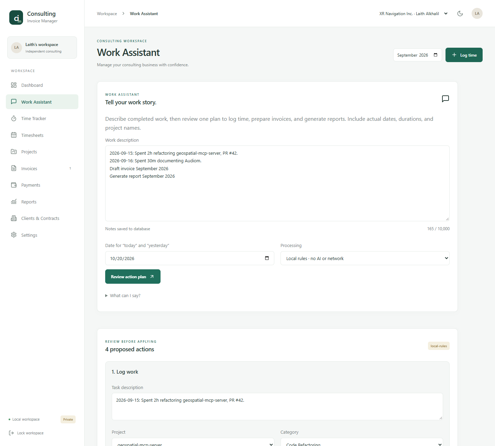
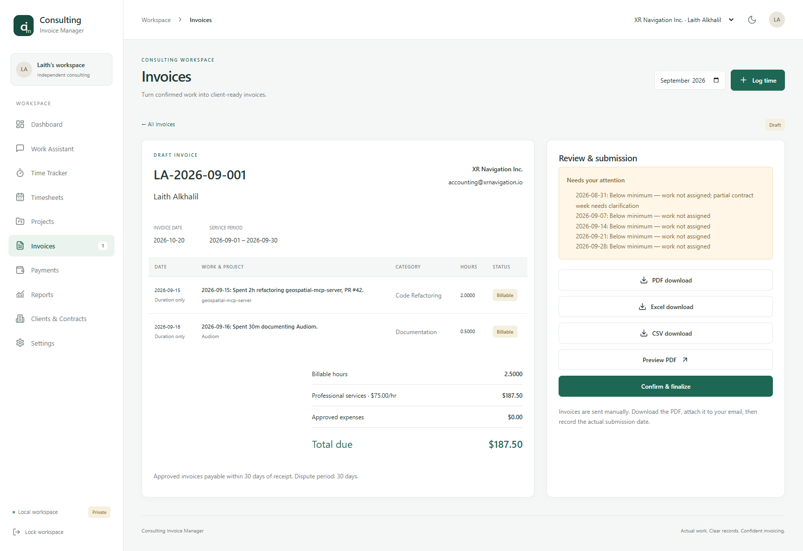
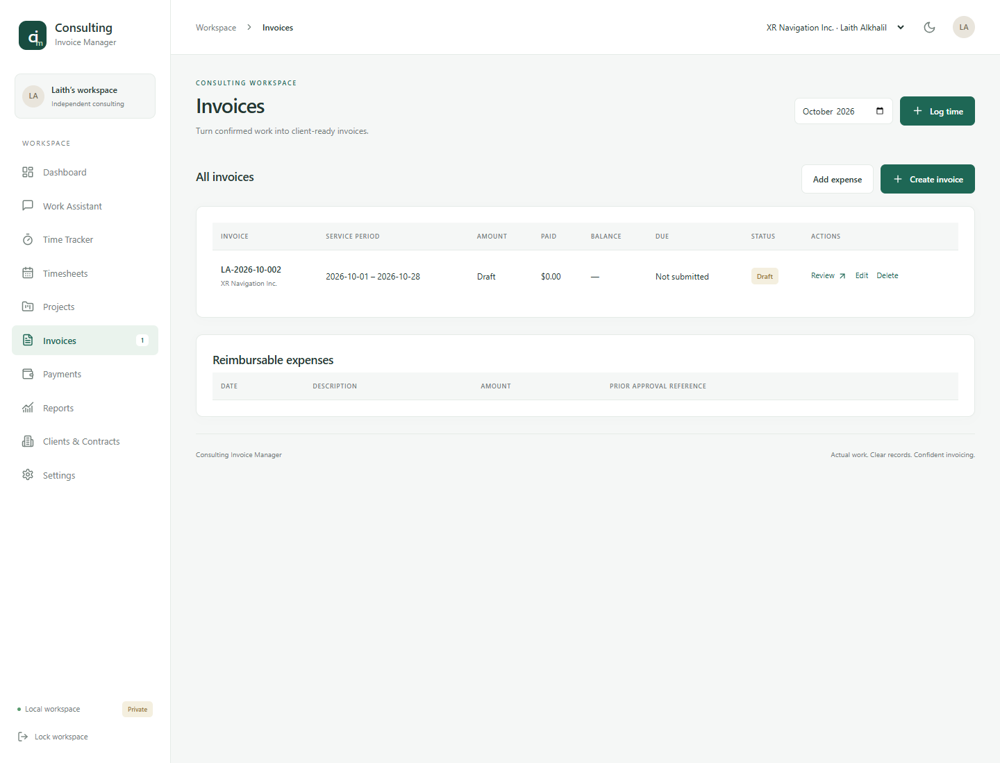
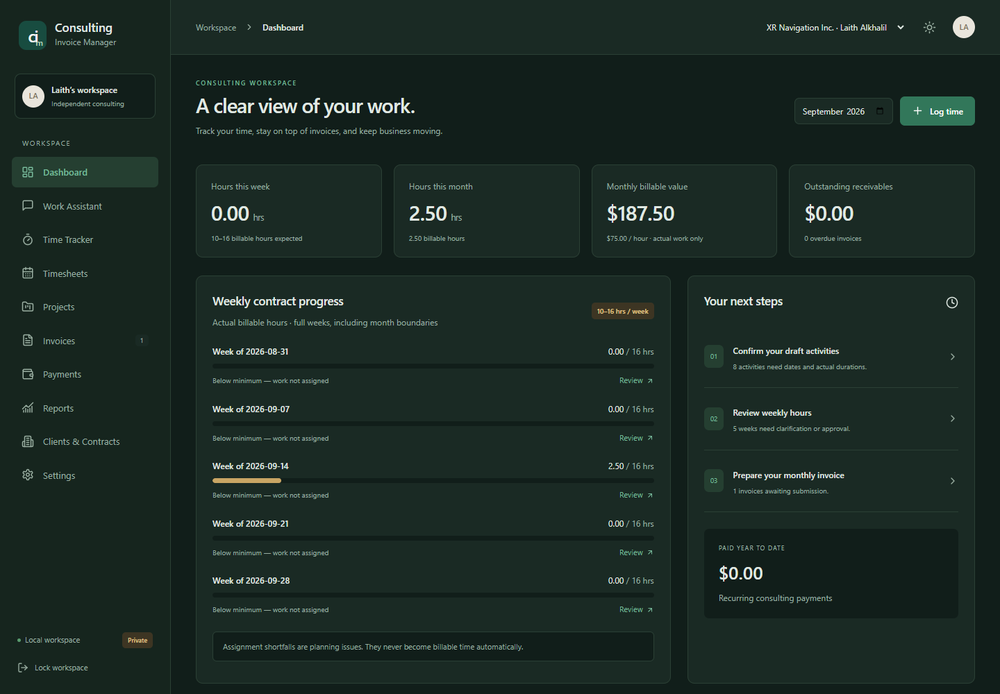
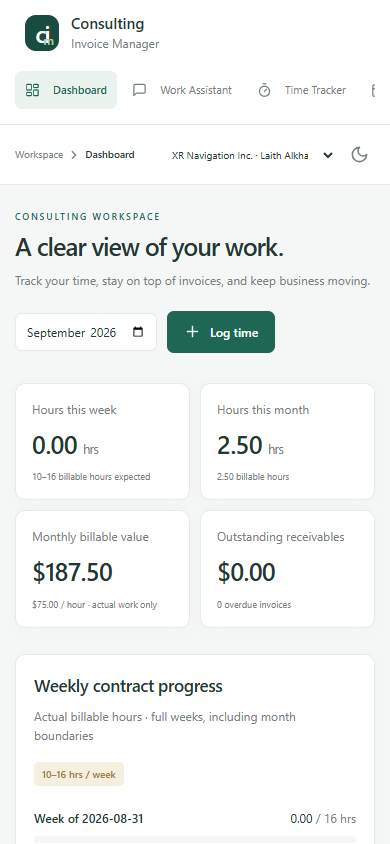
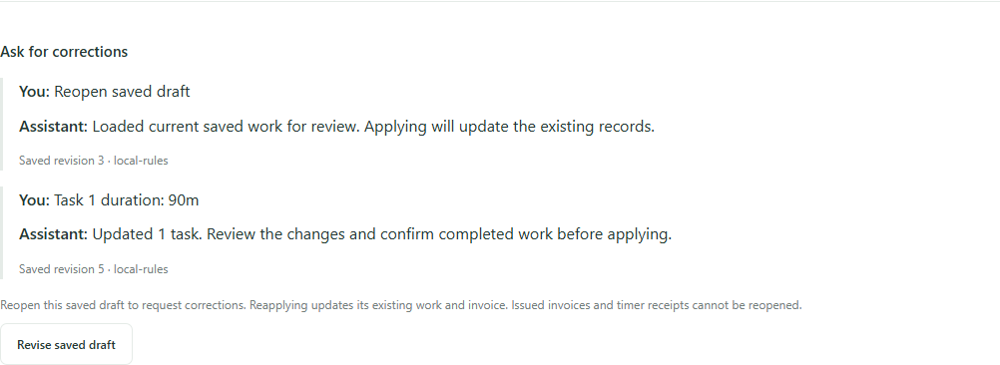
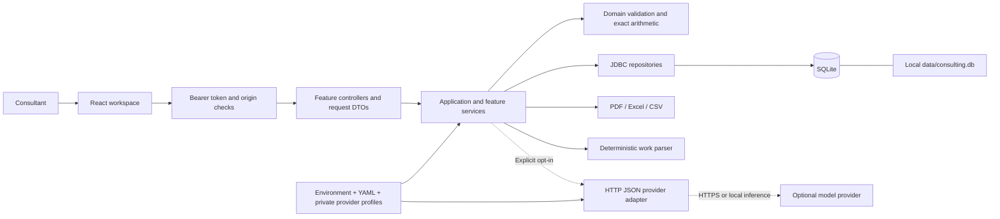
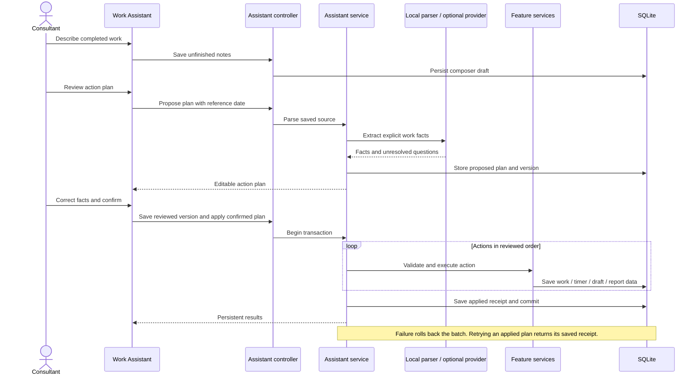
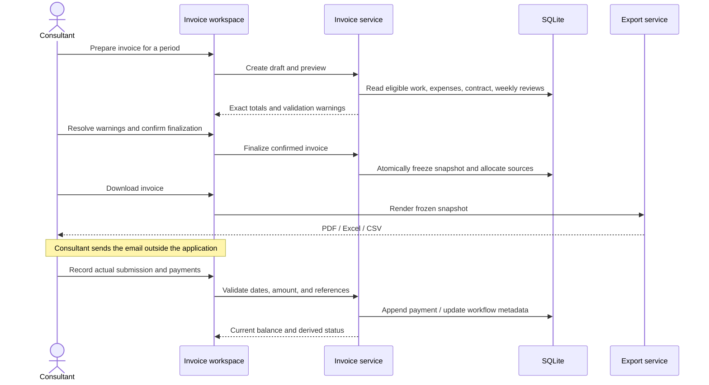

# Consulting Invoice Manager

**Your work, accounted for.** A self-hosted workspace for consulting time, contractual review, invoices, payments, and reporting—with an assistant that turns descriptions of completed work into a reviewable action plan.


Describe your work, review the facts, and apply a plan that logs time, controls timers, prepares invoice drafts, and generates reports. Local rules work without an LLM. Optional provider profiles add professional invoice wording and conversational corrections through a private server-side configuration file. Your records stay in a database on your own disk.

For free-form narratives, [configure a provider API](docs/configuration.md#enable-a-provider-api-for-narrative-intake). The assistant organizes logical work items, retains reference/instruction context, and asks you to resolve missing facts before billing. Local rules support explicit task lines and preserve oversized narratives as nonbillable notes; they do not provide general language understanding.

Designed for a **single-user consulting workflow**. Financial approvals stay explicit: the system does not invent hours, authorize contractual adjustments, record assumed payments, or send email.

Remove unwanted **Saved conversations** with their **Delete** button. Confirmation removes the conversation from the list without removing work entries, invoices, or linked billing review evidence. This is a soft deletion; retained conversations remain accessible through invoice review links. Current composer notes stay separate.

Create an invoice draft directly from a saved work plan, whether proposed or already applied, then review pending work separately from billable charges. Draft invoices support period/date, presentation, adjustment, and notes edits, plus deletion with retained audit history. Use **Edit** or **Delete** directly in the **All invoices** list, or open **Review** for detailed controls. Saving updates SQLite and refreshes the list; deleting a draft keeps its work entries and expenses available. Work entries and unallocated expenses support deletion; clients, contracts, and projects support archive/restore. Issued invoices use documented withdrawal/replacement to preserve accounting history.

Have a proposed weekly work breakdown? The assistant [reads allocation tables locally](docs/work-assistant.md#proposed-work-tables-and-billing-questions), separates proposed and planned hours from actual time, preserves exact invoice periods, and requires resolution of billing questions. Split tasks into actual daily portions and confirm performed work before enabling invoice preparation.



## Explore

[Features](#features) · [Quick start](#quick-start) · [Architecture](#architecture) · [Workflows](#workflows) · [Configuration](#configuration) · [Development](#development) · [Data and operations](#data-and-operations) · [Hosting](#hosting)

## Features

| Workspace           | What it does                                                                                                                                                          |
| ------------------- | --------------------------------------------------------------------------------------------------------------------------------------------------------------------- |
| Work Assistant      | Saves notes; proposes invoice wording and work facts; accepts corrections; applies reviewed plans atomically; reopens unfinalized drafts without duplicating records. |
| Time Tracker        | Tracks one running/paused timer; records actual durations; keeps incomplete or estimated activities as drafts.                                                        |
| Timesheets          | Reviews full contractual weeks, including month boundaries; records availability, written exceptions, and overtime references.                                        |
| Clients & Contracts | Manages clients, projects, repositories, hourly rates, weekly expectations, payment terms, and payment instructions.                                                  |
| Invoices            | Prepares dated itemized/grouped drafts; validates eligibility; freezes issued snapshots; exports PDF, Excel, and CSV.                                                 |
| Corrections         | Withdraws an unpaid issued invoice with a reason, releases its source records for correction, and links the replacement while preserving history.                     |
| Payments            | Appends actual receipts; calculates balances, partial payment, due dates, and overdue status; separates historical prior-work receipts.                               |
| Reports             | Shows confirmed actual and billable time, project breakdowns, and services value.                                                                                     |
| Local storage       | Persists financial records, timer state, notes, plans, snapshots, and audit history in SQLite; includes verified backup tooling.                                      |

### System views

Screenshots use an isolated demonstration database, not the live financial database.

| Describe and review work                     | Review an invoice                          |
| -------------------------------------------- | ------------------------------------------ |
|  |  |

Manage draft invoices directly from the list:



<details>
<summary>Dark theme and mobile layout</summary>





</details>

### Correct an invoice through conversation



Choose a configured language provider to rewrite everyday notes and interpret correction requests. Offline mode offers basic wording cleanup and explicit corrections such as `Task 1 duration: 90m`. Both paths require actual facts and your review.

## Quick start

### Docker Desktop

Prerequisites: Docker Desktop with Linux containers and Docker Compose.

1. Copy `.env.example` to `.env`.
2. Replace `APP_TOKEN` with a private random secret of at least 24 characters. A password manager can generate it. Never commit this file.
3. Start the application:

```bash
docker compose up --build -d
```

4. Open **http://127.0.0.1:8080** and enter your token. If that port is unavailable, change `APP_PORT` in `.env` and recreate the service. This workstation uses **http://127.0.0.1:18080**.

```bash
docker compose logs -f app
docker compose stop app
docker compose up -d
```

Compose publishes only localhost. The database is bind-mounted at `data/consulting.db`; recreating the container preserves it. The provider directory is mounted read-only. No AI credentials, mail service, or cloud account are needed to use the local workflow.

### Native Windows installation

Install Java 21+, Maven 3.9+, Node.js 22.12+, npm, and PowerShell 7+. From the repository root:

```powershell
$env:JAVA_HOME = 'C:\Program Files\Java\jdk-21' # adapt to your installation
$env:APP_TOKEN = '<your private random secret>'
./scripts/start-local.ps1
```

The script builds the frontend, packages and tests the backend, then starts the application. If `APP_TOKEN` is omitted, it generates and displays a private session token. The packaged application uses the root `data/consulting.db` by default.

## Architecture

The application is a modular monolith: one Java process, one transactional database, and a React frontend. Feature services own business rules; repositories own SQL; controllers adapt HTTP requests. The assistant and exports reuse the same application services as the manual workflow.



### Technology stack

| Layer        | Technology                                                   | Responsibility                                                            |
| ------------ | ------------------------------------------------------------ | ------------------------------------------------------------------------- |
| Frontend     | React 19, TypeScript, Vite 7                                 | Workspace, feature screens, state coordination, API transport             |
| UI           | Tailwind CSS 4, Radix Dialog, Lucide                         | Styling, accessible dialog primitives, icons, responsive layouts          |
| Backend      | Java 21, Spring Boot 3.5, Spring MVC, Bean Validation        | REST adapters, typed configuration, service transactions, validation      |
| Persistence  | Spring JDBC, SQLite, Flyway                                  | Explicit repositories, versioned schema, immutable snapshots, audit trail |
| Documents    | PDFBox, Apache POI                                           | Paginated invoices, workbooks, CSV exports                                |
| Verification | JUnit, Mockito, MockMvc, Vitest, Testing Library, Playwright | Domain, configuration, architecture, HTTP, UI, and browser workflows      |
| Delivery     | Multi-stage Docker build, Docker Compose, GitHub Actions     | Build verification, local runtime, optional static frontend deployment    |

Dependency versions are pinned by `backend/pom.xml` and `frontend/package-lock.json`. The application currently uses USD and cent-level, half-up rounding per work line. Decimal snapshot values are reloaded as `BigDecimal`.

### Repository layout

```text
backend/
  src/main/java/io/consulting/
    config/          # Validated runtime settings and OpenAPI configuration
    controller/      # Feature-oriented HTTP adapters
    domain/          # Framework-independent values, periods, and work parsing
    dto/             # Typed HTTP requests and error envelopes
    exception/       # Central HTTP error translation
    integration/ai/  # Optional HTTP JSON provider adapter
    repository/      # Parameterized JDBC queries and persistence
    security/        # Bearer token and configured-origin checks
    service/         # Clients, time, compliance, invoices, expenses, payments
      assistant/     # Versioned plans and atomic orchestration
      export/        # PDF, Excel, and CSV generation
    support/         # Decimal-safe JSON and request mapping
    validation/      # Bounded request bodies
  src/main/resources/
    application.yml  # Environment-backed runtime defaults
    db/migration/    # Applied Flyway migrations: never edit in place
  src/test/java/     # Feature, HTTP, configuration, and architecture checks
frontend/
  src/
    app/             # Workspace composition, navigation, and context
    components/      # Shared UI controls and tables
    config/          # Public frontend configuration
    features/        # Pages, dialogs, and assistant views by feature
    hooks/           # Workspace loading and mutation coordination
    lib/             # API transport, forms, dates, money, and time helpers
  e2e/               # Isolated browser workflows and screenshot tooling
config/              # Public provider template and ignored private profiles
scripts/             # Local startup and consistent database backups
docs/                # Design, development, configuration, API, verification, images
.github/workflows/   # CI and optional manually triggered Pages deployment
```

There is no JPA entity layer: this SQLite implementation uses explicit JDBC projections and Flyway-owned schema. Request DTOs define the HTTP boundary; service validation owns billing decisions. See [architecture decisions](docs/architecture.md) for transaction and dependency boundaries.

## Workflows

### Describe completed work

Open **Work Assistant**, select the active contract, and enter one task or command per line:

```text
2026-09-15: Spent 2h refactoring geospatial-mcp-server, PR #42.
2026-09-16: Spent 30m documenting Audiom.
Draft invoice September 2026
Generate report September 2026
```

Review dates, project assignment, categories, billing flags, and actual durations. Apply the plan once. This example produces 2.5 actual hours, an invoice draft from eligible unbilled work, and a report. An invoice draft still needs contractual review and finalization.

**Prepare an invoice** is selected by default for work notes. Check its visible service period, or specify an invoice command with its month. Provider-generated wording and corrections stay draft until you confirm the affected work. Ask for corrections before applying, or choose **Revise saved draft** afterward to update the same entries and unfinalized invoice. Review its dated line items and warnings, then finalize and export from invoice review. The assistant cannot change issued snapshots or submit an invoice.

The parser accepts ISO dates, named dates, “today”/“yesterday”, numeric durations such as `1h 30m`, and clock ranges such as `09:00–11:00`. Missing facts and estimates stay draft. Duration-only entries retain no invented clock start; clock overlaps can only be checked when times are supplied.



See [assistant grammar and provider setup](docs/work-assistant.md) for timer commands, compliance review, and submission-email preparation.

### From actual work to payment

1. Log actual work, or stop a timer and verify the resulting draft.
2. Review weekly availability, shortfalls, partial weeks, and written overtime/exception references.
3. Create an invoice draft for the service period. Only eligible confirmed billable work and period expenses are selected.
4. Resolve validation warnings; explicitly finalize to freeze the invoice and allocate its source records.
5. Download the PDF/workbook/CSV. Prepare the email, attach the PDF, and send it in your mail application.
6. Record the actual submission/receipt date, review status, and actual payments.



Shortfalls never manufacture time. Minimum-charge adjustments require their own reason and explicit approval reference. Issued snapshots remain unchanged. An unpaid invoice can be withdrawn for a documented correction and replaced; invoices with payment events require an accounting credit/refund process, which is outside this release.

### Initial workspace data

The database seeds one consulting contract, three projects, and seven incomplete activities. Their dates and durations must be confirmed before billing. The historical $4,000 prior-work receipt is separate and initially unconfirmed; it never enters recurring invoice totals. No payment credentials are seeded.

## Configuration

| Configuration                           | Location                                          | When changes apply                                                          |
| --------------------------------------- | ------------------------------------------------- | --------------------------------------------------------------------------- |
| Runtime settings and defaults           | `backend/src/main/resources/application.yml`      | Backend restart; environment variables override defaults                    |
| Docker settings                         | Root `.env`, based on `.env.example`              | Recreate the Compose service; rebuild for public frontend build settings    |
| Contract and billing terms              | Clients & Contracts in the application            | Persisted in SQLite; issued snapshots retain their original terms           |
| Optional model profiles and credentials | `config/assistant-providers.json`                 | Read on each request; reload the assistant selector after changing profiles |
| Public frontend settings                | `frontend/.env`, based on `frontend/.env.example` | Restart Vite or rebuild the frontend                                        |

Common runtime settings include `APP_TOKEN`, `APP_PORT`, `DATA_DIR`, `APP_ALLOWED_ORIGINS`, `INVOICE_NUMBER_PREFIX`, assistant resource/history limits, provider timeouts, and response-size limits. Configuration is validated at startup. Currency arithmetic, immutable snapshots, and explicit financial confirmation are business invariants rather than configurable bypasses.

**Provider credentials belong on the backend.** The example file includes disabled local Ollama, chat-completion JSON, and messages-style profiles. New compatible HTTP JSON APIs can be added without rebuilding. Streaming, OAuth refresh, custom signing, and non-JSON protocols require adapter work. No provider is enabled by default, and every provider-assisted description requires consent.

See the [complete configuration reference](docs/configuration.md). Never put secrets in `VITE_*` settings: they are public build output.

## Development

Prerequisites: Java 21+, Maven 3.9+, Node.js 22.12+, npm, and Chrome for the browser scripts.

### Two-process development

In terminal 1, from the repository root:

```powershell
$env:APP_TOKEN = '<private development token of at least 24 characters>'
$env:DB_PATH = Join-Path (Get-Location) 'tmp/development.db'
New-Item -ItemType Directory -Force tmp | Out-Null
mvn -f backend/pom.xml spring-boot:run
```

Use a separate development database. In terminal 2:

```bash
cd frontend
npm ci
npm run dev
```

Open http://127.0.0.1:5173. Vite proxies `/api` to the backend on port 8080. Adjust `VITE_DEV_API_TARGET` if needed. Use the backend token to unlock the workspace.

### Quality checks

```bash
mvn -f backend/pom.xml clean verify
npm --prefix frontend ci
npm --prefix frontend run format:check
npm --prefix frontend run typecheck
npm --prefix frontend test
npm --prefix frontend run build
```

Run `npm --prefix frontend run format` to apply repository formatting. Java uses four-space indentation; TypeScript, JSON, YAML, and CSS use two. `.editorconfig`, Prettier configuration, strict TypeScript, lockfiles, and CI keep these conventions repeatable. Formatting excludes applied migrations, credentials, databases, backups, generated assets, and dependencies.

Backend checks cover ledger arithmetic, snapshots, corrections, overlap/duplicate protection, assistant atomicity and retries, provider source validation, typed HTTP requests, configuration constraints, and package dependency rules. Frontend checks cover authorization state, UI behavior, assistant review, and save failures. Browser scripts exercise full financial and assistant workflows against disposable databases.

See [developer setup and contribution guide](docs/development.md), [API reference](docs/api.md), and [executed verification results](docs/verification.md).

### Swagger and OpenAPI

Once the backend is running on this workstation:

- [Swagger UI](http://127.0.0.1:18080/swagger-ui/index.html) — interactive reference and requests.
- [OpenAPI JSON](http://127.0.0.1:18080/v3/api-docs) and [OpenAPI YAML](http://127.0.0.1:18080/v3/api-docs.yaml) — generated specifications.
- [Swagger shortcut](http://127.0.0.1:18080/swagger-ui.html) and [UI configuration](http://127.0.0.1:18080/v3/api-docs/swagger-config).

Fresh installs/native Java use port 8080 by default; substitute your backend origin when different. In **Authorize**, enter only the `APP_TOKEN` value: Swagger supplies the bearer prefix. Documentation is readable without a token, while `/api/**` operations require it. Set `API_DOCS_ENABLED=false` and recreate/restart the backend to disable documentation. See [all Swagger URLs, runtime addresses, authorization, and troubleshooting](docs/api.md#swagger-and-openapi-urls).

## Data and operations

### Persistence and backups

The default packaged application and Docker deployment use **`data/consulting.db` on your disk**. `DATA_DIR` selects another Docker host directory; `DB_PATH` selects the native database path. Browser storage holds the theme and session token, not the financial database. Avoid running two application instances against the same SQLite file.

Create a consistent online backup with Python 3:

```powershell
./scripts/backup.ps1 -Database ./data/consulting.db -Destination ./backups
```

The tool uses SQLite's backup API, refuses to overwrite existing backup files, and verifies integrity. Keep encrypted copies outside this machine. Persistence survives restarts and container recreation; recovery from disk failure or accidental deletion depends on backups.

Restore with the application stopped: first back up the current file, verify the chosen backup with `PRAGMA integrity_check`, replace the database, and restart. Verify invoices, balances, and audit history. See [operations and restore details](docs/operations.md). Never copy a live SQLite file with an ordinary file copy.

### Upgrade

1. Back up the database and retain the current release/configuration.
2. Build and test the new release.
3. Recreate the service with `docker compose up --build -d`.
4. Check logs, migrations, workspace records, and balances.

Flyway validates and applies versioned migrations at startup. Do not edit an applied migration to change existing installations. A downgrade is not an automatic schema rollback; recover through a compatible release or a verified backup.

### Runtime boundary

The Docker runtime runs as UID 10001, publishes localhost only, drops Linux capabilities, uses a read-only root filesystem, and keeps an executable temporary mount for SQLite JDBC's native library. The data bind mount remains writable. Sharing the backend beyond this local single-user setup requires HTTPS, suitable identity/access controls, and protected backups; publishing a frontend does not provide those controls.

## Hosting

**GitHub Pages can host the React frontend.** It cannot run Java, SQLite, provider credentials, or write to your local disk. A Pages deployment needs a separately running backend with persistent storage, HTTPS reachability, and an explicit frontend-origin allowlist.

The optional, manually triggered `.github/workflows/pages.yml` publishes only the frontend after `VITE_API_BASE_URL` is configured as a repository variable. Nothing is published automatically. To keep the database on your local disk, keep the backend on your machine and provide secure reachability rather than assuming a Pages URL can access it.

See [Pages deployment instructions](docs/work-assistant.md#github-pages) and [GitHub's hosting model](https://docs.github.com/en/pages/getting-started-with-github-pages/what-is-github-pages).

## Documentation

- [Architecture and decisions](docs/architecture.md)
- [Configuration reference](docs/configuration.md)
- [Developer setup and extension guide](docs/development.md)
- [API reference](docs/api.md)
- [Work Assistant and provider adapters](docs/work-assistant.md)
- [Operations, backup, and restore](docs/operations.md)
- [Verification results](docs/verification.md)
- [Sample draft PDF](docs/sample-invoice.pdf)
