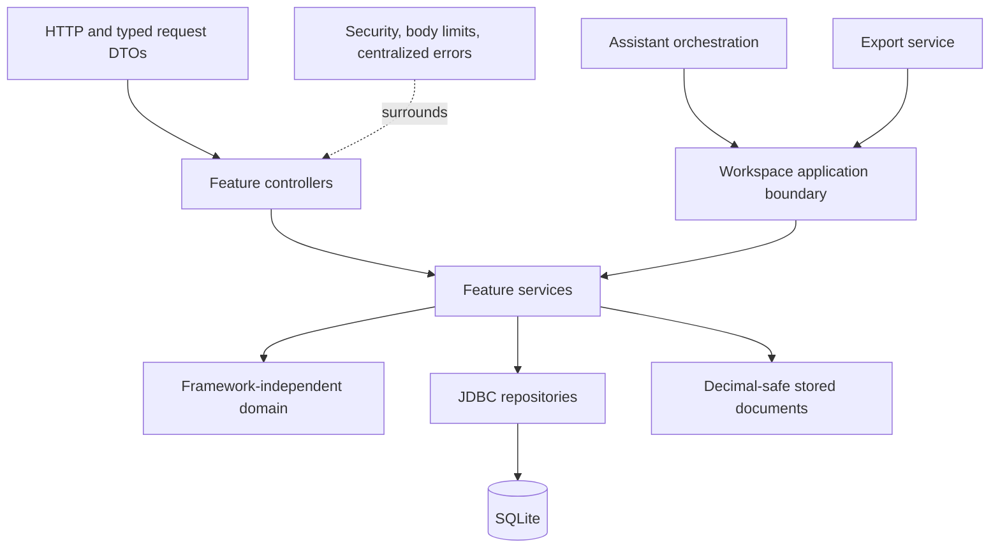

# Architecture and design

Invoice draft creation from a saved assistant plan is a transaction that stores the draft and server-owned `_invoice_id` binding together. Both proposed and applied plans are supported. Applied work is never replayed: invoice receipt bindings are appended or reused while work IDs and status remain intact, including older receipts without explicit bindings. Draft preview reads linked plan state and separates pending/planned work from chargeable ledger entries. It blocks finalization until plan and invoice validation pass. Draft edits use a SHA-256 fingerprint of the current stored invoice as an optimistic edit token; linked plan periods and versions update in the same transaction. Draft deletion is a retained `Deleted` state, preserving invoice numbers and audit identity, and removes active plan bindings. Issued invoices continue to use immutable snapshots and documented replacements.

Flyway V4 introduces a `record_archives` registry for clients, contracts, and projects. Archiving preserves foreign keys and business rows; effective archive state includes the parent client while independent child flags survive restoration. New-work services and timer creation enforce this state. The registry is exposed through the client management service and an allowlisted lifecycle repository. Unallocated expenses retain audited direct deletion.

The root README contains the deployment flow and two end-to-end sequence diagrams. This document explains implementation boundaries and decisions.

Allocation-table intake is implemented in `domain.assistant.StructuredWorkIntake`. It runs before model extraction, keeps proposed hour strings separate from actual seconds, carries inherited allocation ranges, and classifies planned rows as note actions. Billing questions use a required, explicit resolution field. Source metadata is immutable during review; the server enforces resolution and future-date checks before ledger mutations. Daily splitting appends blank draft portions with optimistic version checks, preserves existing action identities, and executes work before invoice/report snapshots. No additional database migration is required: the versioned plan JSON persists the intake metadata.

Provider failures use bounded response reads and the `integration.ai.ProviderFailure` classifier. Recognized error codes determine fixed public messages for quota, throttling, or permissions. Provider-supplied message text is never returned to the client. There are no automatic paid-request retries.

## Modular monolith

One Spring Boot process owns the API, transactional application services, SQLite access, and exports. The packaged React assets share the same origin by default. A configured frontend origin/API URL supports a split deployment without changing business services.

Controllers do not access JDBC, repositories, or model-provider implementations. Repositories do not call services/controllers. Domain code does not import Spring or application adapters. These boundaries are checked by `PackageBoundariesTest`.

`WorkspaceService` aggregates application operations for assistant/export integrations. It has no SQL or financial policy. Manual HTTP requests call their owning feature services. Constructor injection and explicit dependencies make both routes visible.

## Persistence model

SQLite plus Spring JDBC was chosen for a local, inspectable database and explicit queries. There are no JPA entities; HTTP requests use typed DTOs and repositories return JDBC projections. `RequestMapper` adapts optional wire fields without inventing defaults. `RecordRepository` restricts dynamic table names to an allowlist; query values are bound parameters.

Flyway owns schema history. V1 establishes clients, contracts, projects, work, weekly reviews, expenses, invoices, allocations, payments, historical receipts, and audit events. V2 adds composer drafts, assistant plans, and untimed-duplicate protection. V3 adds versioned conversation instructions, replies, and before/after plan snapshots. Applied SQL files are excluded from formatting and must not be edited.

Invoice snapshots are immutable JSON documents. `JsonDocuments` reloads decimal JSON values as `BigDecimal`, preserving exact arithmetic rather than converting through binary floating point. Issued invoice rendering uses its stored snapshot; later contract/project edits do not rewrite historical contents.

A PostgreSQL migration would require adapting SQLite identity retrieval, DDL/migrations, date handling, connection configuration, and data transfer verification. It is not a currently selectable storage switch.

## Transaction boundaries

Feature mutation methods carry `@Transactional`. Finalization validates, freezes the snapshot, allocates work/expenses uniquely, and handles linked replacement in one transaction. Payment events and their audit records share the same transaction. The singleton timer and one-connection SQLite pool serialize writes.

Assistant network extraction happens outside a database transaction. Source notes are saved before parsing/network work. Proposal stores a versioned plan without ledger mutations. A review update checks/increments its version. Applying a confirmed plan executes its actions through feature services and stores the receipt in one transaction. Failure rolls back the batch; repeating an applied plan returns the stored receipt instead of repeating its financial actions.

`AssistantRevisionService` interprets local corrections or requests provider suggestions outside a database transaction. `AssistantRevisionStore` checks the expected proposed version and atomically saves the plan and immutable revision snapshots. `AssistantReceiptService` reopens editable receipts, binds saved work/invoice IDs, and captures current entry baselines. Reapplication checks those baselines and allocation/snapshot restrictions before updating existing records. `AssistantReportingService` computes review values and reports using exact ledger arithmetic. Flyway V3 adds correction history without changing existing migrations or ledger records.

An invoice draft is a mutable preview, not an issued document. Allocation happens only at explicit finalization. Editing an issued source record is blocked while allocated. Explicit withdrawal of an unpaid invoice preserves its snapshot and releases sources; finalizing the linked replacement marks the original Replaced. Paid invoices cannot use this correction flow because credit/refund accounting is outside the implementation.

## Financial invariants

- Durations are integer seconds. Confirmed work requires an actual date and positive duration, at most 24 hours per entry.
- Supplied clock ranges must fit a local day and not overlap other timed entries. Duration-only work has no invented start time and cannot undergo clock-overlap checks. Exact untimed duplicates are rejected.
- USD amounts use `BigDecimal`. Each work line is rounded half-up to cents before totals are added.
- Weekly compliance uses the configured whole week, including adjacent-month work. Invoice periods select only their own dated work.
- Partial contract weeks retain the configured minimum and require review. A shortfall acknowledgement never creates charges. Overtime and optional minimum-charge adjustments need their own written references/approval.
- Due dates and balances derive from actual submission dates and append-only payment events. Paid/partial/overdue display states do not erase the underlying review state.
- Historical prior-work receipts remain separate from recurring revenue and invoices.

## Assistant and provider boundary

The deterministic parser handles bounded facts and commands. Missing, estimated, negated, or ambiguous facts remain drafts. Project/category choices are reviewable. Raw source is retained with the plan.

`LocalWorkPlanParser` selects Automatic, strict Task lines, or Narrative notes behavior. It applies the configured review-action budget rather than counting every source line as a required ledger mutation. Oversized automatic inputs become a `save_note` plan retaining the entire narrative; applying it records only the conversation receipt. Provider work spans are treated as logical work items with multiline evidence, while context spans become nonbillable notes. Neither path can derive actual hours from issue counts or mark unperformed work complete. Automatic invoice steps count toward the same action budget.

The optional HTTP JSON provider client reads private profiles on each request, renders request/header templates, enforces endpoint/redirect/size/time limits, and validates returned source spans. All non-whitespace source—including signs and punctuation—must be covered by disjoint verbatim spans. Dates and durations are reparsed locally, and provider suggestions are always drafts. The provider gets no tools, SQL access, or financial approval capability.

Profiles support compatible HTTP JSON APIs through configuration. Streaming, OAuth refresh, custom signing, and non-JSON protocols require adapter code. Credentials are not included in selector metadata or stored assistant history.

Springdoc generates the OpenAPI JSON/YAML specifications and Swagger UI from controller mappings and request DTOs. `OpenApiConfiguration` declares the `localToken` HTTP bearer scheme. `API_DOCS_ENABLED` controls the documentation endpoints; the bearer filter independently protects `/api/**` operations. See the [Swagger route and runtime reference](api.md#swagger-and-openapi-urls).

## Frontend composition

`App` composes a workspace provider and shell. Navigation is typed configuration. A workspace hook coordinates authorized refreshes, selections, mutations, timer display, and notifications. Pages and dialogs live with their features; assistant state, editors, and receipts have their own modules. HTTP transport and date/time/money formatting have separate utility modules. CSS modules preserve the original cascade order.

A late authorized request cannot reopen a locked workspace: refreshes verify the current session token and sequence. Composer writes are serialized so an older slow response cannot overwrite newer wording. Failed saves keep notes visible. Plan application is explicitly confirmed and versioned.

Public frontend settings are build configuration. Database records are fetched from the backend; browser storage contains only the session token and theme preference. No financial database is stored in localStorage.

## Deployment and access

Compose binds localhost and mounts the host database directory. The runtime is non-root with a read-only root filesystem, dropped capabilities, and an executable temporary mount for SQLite JDBC. A static Pages frontend needs a separate HTTPS backend and a configured exact origin allowlist. CORS does not replace bearer authentication.

The current identity model is single-user. Remote sharing requires suitable identity/access controls and protected backups. Email sending, binary attachment uploads, multi-user roles, credit/refund accounting, and selectable PostgreSQL storage are outside the release.
