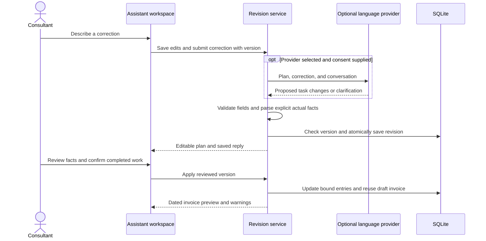

# Work Assistant

Open **Work Assistant** in the sidebar. Local rules are the default: no model, API key, network connection, or AI service is required. The app converts one task per line into an editable plan with basic wording cleanup. Choose a configured language provider for professional invoice descriptions and conversational corrections. Review and apply the plan to log completed work, control timers, draft an invoice, and generate a report together.

```text
2026-09-15: Spent 2h refactoring geospatial-mcp-server, PR #42.
2026-09-16: Spent 30m documenting Audiom.
Draft invoice September 2026
Generate report September 2026
```

This logs 2.5 actual hours, prepares a September invoice draft from eligible unbilled work, and returns a project report. Select **Review invoice** in the receipt to preview/export and resolve billing warnings before finalization. Invoice drafting does not finalize or submit an invoice.

Supported details:

- Dates: ISO dates, “today”, “yesterday”, or “September 15, 2026”. Relative dates use the visible assistant reference date, retained with the plan.
- Duration: `2h`, `30m`, `1h 30m`, or `09:00–11:00`. No clock start is invented for duration-only work. Clock overlaps can only be checked when clock times are supplied.
- Use known project names. `Date: 2026-09-15` and `Project: Audiom` set context for following task lines.
- Category is a reviewable keyword suggestion. References such as PR numbers and links remain attached to the entry. “nonbillable” marks work as nonbillable.
- Missing/estimated/negated hours and ambiguous dates remain draft work, excluded from billing. Aggregate `Total:` lines are not distributed among tasks. Use a separate line for each dated task.
- Commands: `Start timer for testing Audiom`, `Pause timer`, `Resume timer`, `Stop timer`, `Draft invoice September 2026`, `Generate report September 2026`, `Review week September 2026`, and `Prepare email for LA-2026-09-001`.

Local rules are deliberately bounded. Arbitrary prose without explicit facts cannot reliably reveal how long you actually worked. Add the missing facts in the review form, or leave the item as a draft. A stopped timer also produces a draft for verifying its date and elapsed time.

Unfinished composer notes autosave to SQLite after a short typing pause; wait for **Notes saved to database** before closing. Save failures remain visible and keep the text in the composer. Plans, original source, reviewed actions, and results persist across restarts. The configured recent-history window (50 plans by default) is shown in the interface; older plans remain in SQLite. Application is transactional and idempotent per plan ID: a failed batch saves no partial ledger changes, and repeating an applied plan returns its stored receipt. A new message creates a new plan, so review it for duplicates. Exact confirmed untimed duplicates and clock overlaps are rejected.

Financial judgments stay explicit: the assistant cannot invent hours, authorize overtime/minimum adjustments, finalize invoices, record payments, withdraw invoices, or send email. Existing invoice, timesheet, and payment screens handle those reviews. Draft and confirmed work remain distinct throughout reporting and billing.

## From everyday notes to a reviewed invoice

1. Describe the work, supplying actual dates, durations, and a known project. A provider may segment prose and suggest concise descriptions, while original notes remain available next to each task. Wording is a suggestion: check its meaning and references against your work.
2. Leave **Prepare an invoice after logging the reviewed work** selected and check its service period. An explicit invoice command in your notes takes precedence over the checkbox period. Timer-only commands do not automatically add an invoice.
3. Review or correct each task. Confirm completed work using its checkbox. Missing facts, estimates, and provider suggestions remain draft until reviewed. Exclude tasks you do not want applied. When preparing an invoice, every included work task must be complete, and billable tasks must fall within a selected invoice period.
4. Save reviewed edits to refresh the server-calculated hours and services value. These figures cover this plan's confirmed tasks. The eventual invoice also selects other eligible unbilled work and expenses in its period.
5. Confirm and apply the plan. Work saves before invoice drafting even when the invoice command appears first. The receipt shows dated invoice descriptions, hours, amounts, total, and outstanding contractual warnings.
6. Ask for further corrections through **Revise saved draft**. Reapply after review to update the same entries and invoice, then open **Review invoice**, resolve remaining warnings, finalize, and export PDF/Excel/CSV for manual submission.

## Correction messages

With a configured provider selected, requests can refer to the task by number or description: “Make task 1 concise and preserve PR #42” or “Change the Audiom task's actual duration to 90 minutes.” Each request needs consent to send the original notes, current plan, prior correction messages, project names, and categories to that provider. No financial records outside that plan are supplied.

Local mode supports one explicit correction per message:

```text
Task 1 description: Refactored Audiom implementation; PR #42.
Task 1 date: 2026-09-15
Task 1 duration: 90m
Task 1 project: Audiom
Task 1 category: Code Refactoring
Task 1 billing: nonbillable
Task 1 exclude: yes
Task 1 include: yes
```

Send each example separately. Corrected tasks return to draft status and require confirmation again. Dates and durations come from deterministic parsing of your entire correction, never from model-provided numeric fields. Supply a single explicit value; ambiguous values prompt a correction instead of a guessed duration. A duration correction clears the old clock start unless the correction supplies a clock range. Use direct review fields for facts the parser cannot resolve.

Conversation edits target existing work tasks; they cannot add or merge tasks, change an existing invoice's period, finalize, or send. Clarification questions save to the conversation without partially changing tasks. Failed provider requests leave the correction text available for retry. Accepted messages, replies, and before/after plan snapshots are stored in SQLite by Flyway V3. `ASSISTANT_MAX_REVISIONS` bounds conversation length; review-field editing remains available after the limit.

Reopening a saved draft binds each action to its existing record. Reapplication reuses its invoice number and work IDs. Excluding previously saved work retains it as a draft rather than deleting it. The original receipt stays stored while a correction is pending. A version check rejects late provider responses, and an entry baseline check prevents overwriting work edited elsewhere. **Reload saved work and discard pending edits** refreshes that baseline. Issued work, finalized invoices, and timer receipts cannot be reopened this way.



## Optional providers

Edit `config/assistant-providers.json`. If it does not exist, copy `config/assistant-providers.example.json` to that filename; the template profiles start disabled. Preserve an existing private file and its configured profiles when upgrading. The real file is gitignored and excluded from the Docker build context. The directory is mounted read-only into the backend. Protect this file like a password; it can contain provider credentials. Do not put keys in `VITE_*` variables, GitHub repository variables, screenshots, or browser storage.

Enable a profile, set its endpoint/model and credentials, then reload the assistant page. Configuration is read on each request: adding, disabling, editing, or deleting profiles needs no app rebuild. Only enabled profiles appear in the selector. Local rules continue to require no provider. Explicit consent is required for each provider-assisted message; the backend then sends the description, known project names, category names, and extraction instructions to that provider.

Profiles define an HTTP JSON request, headers, and a JSON Pointer locating the returned JSON object or JSON text:

| Placeholder / property | Meaning                                                        |
| ---------------------- | -------------------------------------------------------------- |
| `{{input}}`            | Original description                                           |
| `{{instructions}}`     | Bounded extraction/wording or correction instructions          |
| `{{model}}`            | Profile's model value                                          |
| `{{secret:API_KEY}}`   | `credentials.API_KEY` in the server configuration              |
| `{{env:VARIABLE}}`     | Explicitly supplied backend environment variable               |
| `responsePointer`      | For example `/message/content` or `/choices/0/message/content` |

The examples cover local Ollama, a chat-completion JSON shape, and the Anthropic messages shape. Install/select your own model; the examples do not assume a model exists. For Ollama running on the Docker host, use `host.docker.internal`; a native backend can use `localhost`. Remote endpoints must use HTTPS, and redirects are disabled. Environment placeholders work only for variables actually passed to the backend container; shell variables are not automatically forwarded by Compose.

For initial notes, the provider returns `{"segments":[{"source":"exact source span","description":"professional invoice wording","project":"existing project name","category":"existing category"}]}`. `description` is optional for compatibility and limited to 2,000 characters. Spans must be ordered, nonoverlapping, verbatim, and cover all non-whitespace input, including signs and punctuation. Keep context headers with the work they qualify. Commands remain source segments and are parsed locally. A suggested description is used only when its segment produces exactly one work task.

For corrections, the same profile receives different `{{instructions}}` and structured `{{input}}`, and returns `{"changes":[{"task":1,"description":"Revised wording","update_duration":true}],"clarification":""}`. Only the documented correction fields are accepted; direct time/date values, tools, and financial actions are rejected. No profile format change is needed when its request forwards both placeholders and its model can follow the JSON contract.

The server rejects fabricated or omitted source spans, reparses dates/durations with local rules, and saves every model suggestion as draft work. Professional wording still needs human review for semantic accuracy; source validation cannot prove a paraphrase truthful. Providers get no tools or database access. Compatible HTTP JSON providers can be added through configuration; streaming, OAuth refresh, proprietary signing, and non-JSON protocols require an adapter change. External provider examples were not tested with paid accounts; automated tests use mocks and a local HTTP fixture.

## Local data and backups

Docker and the native root-directory startup use `data/consulting.db`. Compose bind-mounts this directory; `DATA_DIR` can select another absolute local directory. Application data does not rely on browser storage or container writable layers. Keep the database outside any published site or Git repository. Do not run two app instances against the same SQLite file.

The pre-upgrade Docker database was cleanly stopped, copied to a timestamped backup under `backups/`, verified, and copied to `data/consulting.db`. The original named volume was retained. Flyway V2 adds assistant tables and duplicate detection; V3 adds persistent correction messages and plan snapshots without modifying existing ledger rows.

Use `scripts/backup.ps1` or `scripts/backup.py` for a consistent online SQLite backup, including when Docker uses the local bind mount. Store encrypted backup copies on another device. Persistence survives app/container restarts; protection against disk failure or accidental deletion requires backups.

## GitHub Pages

GitHub Pages serves static HTML/CSS/JavaScript. It can host this React frontend, but cannot run the Java backend, SQLite, provider credentials, or write to your local disk. The full application therefore cannot run on Pages alone. See [GitHub's Pages overview](https://docs.github.com/en/pages/getting-started-with-github-pages/what-is-github-pages).

An optional manually triggered `.github/workflows/pages.yml` builds and publishes only the frontend. Nothing has been published. To use it:

1. Host the backend separately behind HTTPS with suitable authentication/access controls and persistent storage. For continued local-disk storage, keep the backend on your machine and provide secure reachability; a Pages URL alone cannot access that disk. Browser restrictions make relying on a public HTTPS page calling local HTTP unsuitable as a deployment design.
2. Set the repository variable `VITE_API_BASE_URL` to the backend's HTTPS origin, without `/api` or a trailing slash. It is public build configuration, never a credential.
3. Set backend `APP_ALLOWED_ORIGINS` to the exact frontend origin, such as `https://YOUR_USER.github.io` (no repository path). Restart the backend. CORS permits that origin and the bearer header; it does not replace authentication. No wildcard origins are allowed.
4. Enable GitHub Pages with GitHub Actions, then manually run the workflow. It uses the repository name as `VITE_BASE_PATH`; adjust it to `/` for an account-root site or custom domain.

The current app remains a local single-user deployment. Publishing the static frontend does not make the backend a production multi-user service. For your present workflow, the local Docker app keeps setup and data ownership simplest.
